# 🍊 Orange

**An encrypted computer inside your computer.**

Like a hidden room under a house: Orange creates a locked, encrypted "box" on
your computer. Type `orange`, enter your name and password, and a whole desktop
opens full screen, with its own apps, windows, search, terminal and lock screen.
Close it and everything is sealed again. Outside the box, even the file names
are unreadable.

Works on **Windows**, **macOS** and **Linux**.

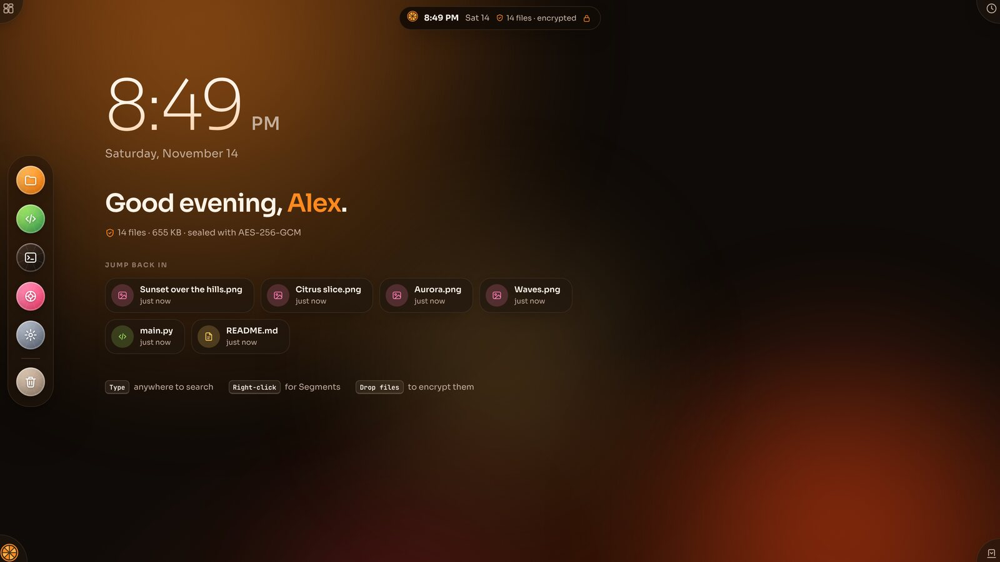

## What's inside

- **Files**: browse, drag in files and whole folders from your computer (encrypted the moment they land), photo thumbnails, Quick Look with Space, rubber-band selection, rename, move, Trash with **Undo**, drag a file out to export it.
- **Code**: an editor with syntax colours, line numbers, live Markdown/HTML preview, and **autosave + encryption as you type**.
- **Terminal**: a shell that only touches the box: `ls`, `cd`, `tree`, `cat`, `echo > file`, `find`, `neofetch` and more.
- **Lens**: photos (zoom, pan, rotate, use as wallpaper), video and music streamed straight from the encrypted box, PDFs.
- **Settings**: Night/Daylight themes, six accent colours, moving wallpapers or your own photo, motion (Full/Calm/Off), sounds, auto-lock, password change, storage ring.
- **Arcade** 🎮: **107 different built-in 2D games** for kids and families, and every one is its own game: speeds, sizes,
  themes and difficulties are **levels you pick on the game's start card**, not extra tiles. Action (Snake, Space Rocks,
  Garden Guard, Road Crosser, Orange Muncher, Cave Glider, Neon Trails, Moon Lander…), sports (Bullseye archery, Hoop Shot,
  Mini Golf, Air Hockey, Bowling, Penalty Kick, Cannon Duel…), puzzles (Ball Sort, Flood It, Picture Logic, Box Pusher,
  2048, Sudoku…), boards and cards (Checkers, Flip Discs, Dots & Boxes, Snakes & Ladders, Sea Hunt, Twenty-One…),
  brain games (Number Tap, Colour Eye, Code Breaker, Capital Cities, Listen & Spell, Tamil Words…) and toys for little
  ones (Pop It, Drum Kit, Colouring Book, Dot to Dot, Feed the Monster, Juicy the pet orange, Orange Farm…).
  Best scores (per level), the pet and the farm are saved encrypted in your box. Press the ⚡ button in any game to see
  FPS, game memory, CPU, RAM and free disk.
- **My Games** ⭐: your own games, built in and playable offline: GAT City (3D), Neon Brawl (vs bots), Finger Ninja and
  Hand Verse (these two use the camera and need internet for hand tracking).
  The Unity Android shooter (2dshooting) is listed with a link: it runs on phones, not inside a desktop window.
- In the Arcade, the **DivyaNik** row opens Speed Reading, Speed Typing and QuestVerse.
- **Learn** 🎓: English A–Z, Tamil உயிர் and மெய் letters, and numbers 1–20. Six activities: picture cards that speak,
  listen-and-find, **trace the letter** (scored with stars), **speak test** (microphone), **reading test** with levels that
  unlock, and picture puzzles. Progress is saved in the box, with a report in `Learning/My progress.md` and every traced
  letter kept as a picture in `Learning/Writing`.
  *The speak and reading tests use Edge/Chrome speech recognition, which needs internet. For Tamil speech on Windows,
  add the Tamil voice: Settings → Time & language → Speech → Add voices.*
- **Paint** 🎨: brush, eraser, fill bucket, lines, rectangles, circles, emoji stamps, 20 colours plus any colour, undo/redo.
  Pictures are saved (encrypted) in `Pictures`.
- **Studio** 🧑‍💻: everything ready offline, nothing to install. **HTML / CSS / JavaScript** and **React** (Preact + htm, bundled)
  with a live sandboxed preview, **Python 3** (runs on your computer, 15 s limit), and **SQL** on a SQLite database that is
  stored encrypted in your box. Save your work into `Projects`.
- **Monitor** 📈: live CPU, RAM, disk (storage) and box size, and how much memory Orange itself is using.
- **Computer** 💻: every app installed on this computer (the Windows Start menu list with its real icons, the macOS
  Applications folder, or Linux's app list), with search, favourites and recents. Click one and it opens in its own
  window; on Windows, Orange steps aside (minimises) so the app is in front. You can also just type an app's name on the
  desktop. Apps open outside the box, so files you save in them are not encrypted by Orange.
- **DivyaNik** 🧭: the DivyaNik learning platform's three modules, working offline inside your box:
  - **Speed Test: Speed Reading.** Timed passages for Junior, Academic and Professional pathways, then a quiz with the
    passage hidden. Reading speed (WPM, labelled as an estimate), comprehension, vocabulary, critical thinking and
    retention, effective WPM, comparison with your last attempt and a progress chart. Reading aloud is rated by a parent
    or teacher and kept apart from the automatic score.
  - **Speed Test: Speed Typing.** Five levels (pass twice to unlock the next), tests of 30 seconds to 10 minutes, live WPM
    and accuracy, gross and net WPM, consistency, a 100-mark score, weak-key analysis and history. Paste and drop are
    blocked; suspiciously regular or impossibly fast typing is flagged and never certified. Certificate tests use their
    own passages and save a certificate picture in `DivyaNik/Certificates`. Put your own passages in
    `DivyaNik/Typing passages.txt` (one per paragraph) and they join the tests.
  - **QuestVerse.** A monthly edition of missions by age band (4–6 up to 26+): sequence ordering, word builder, heritage
    quiz and picture matching (scored automatically, 3 tries, growth from first to latest try), an eco-city plan with
    100 points to share, photo and talk submissions and a written reflection. Creative work goes to a review desk where a
    parent or teacher scores it with a four-part rubric; software never scores creativity. PRISM Explorer → Voyager →
    Champion → Master badges come with a certificate.
  - **Publishing House.** Write a book chapter by chapter (autosaved and encrypted), add a pen name, category, language,
    description and a cover, accept the author agreement (a parent approves for under-18s), send it to an editor who can
    comment, approve, ask for changes or decline, then publish it to your bookshelf. Export an **EPUB ebook** or print to
    PDF at any time.

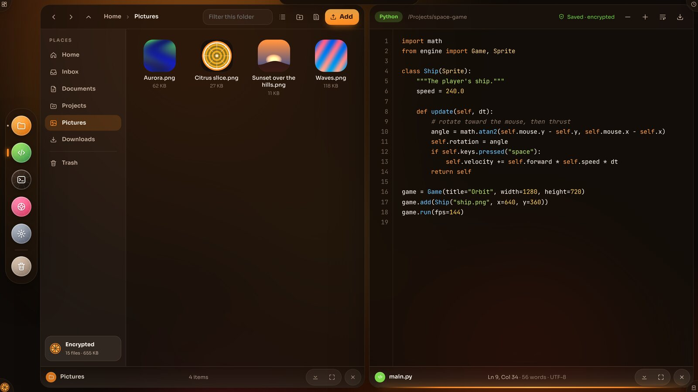

| | |
|---|---|
| 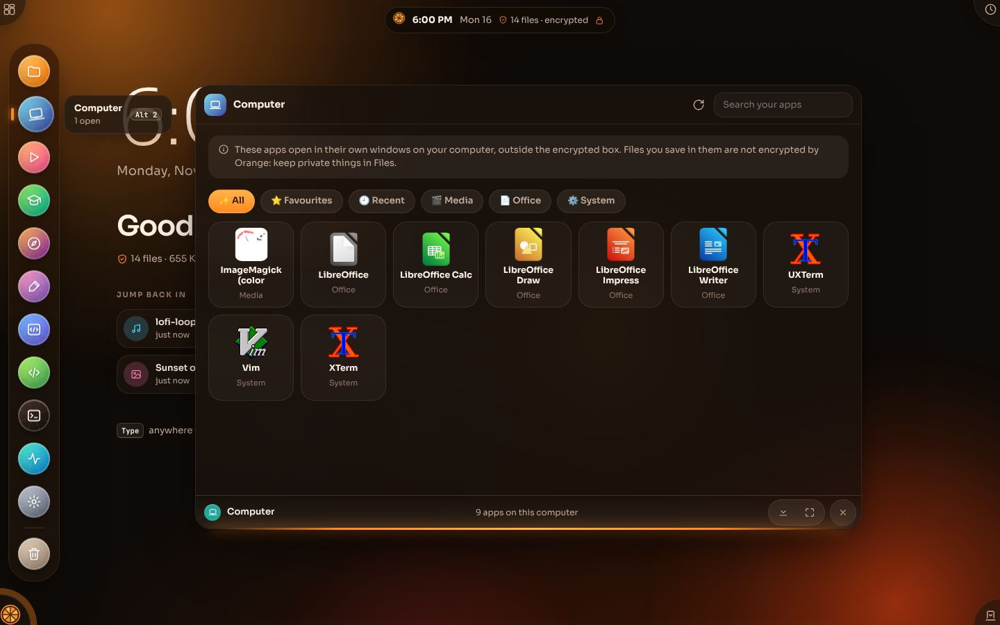 **Computer**: the apps on your PC, opened from Orange | 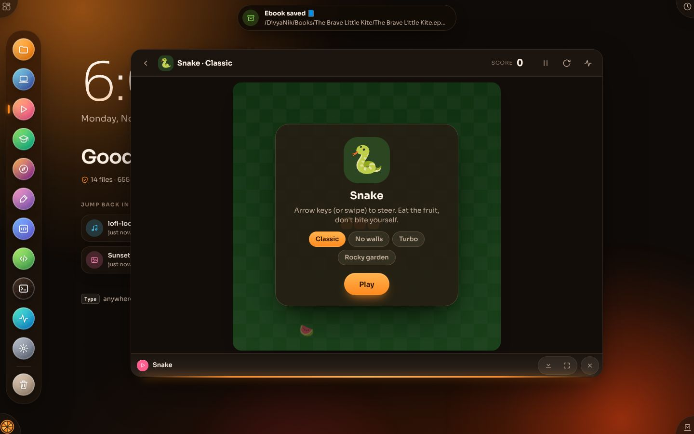 **Levels**: one tile per game, levels on the start card |
| 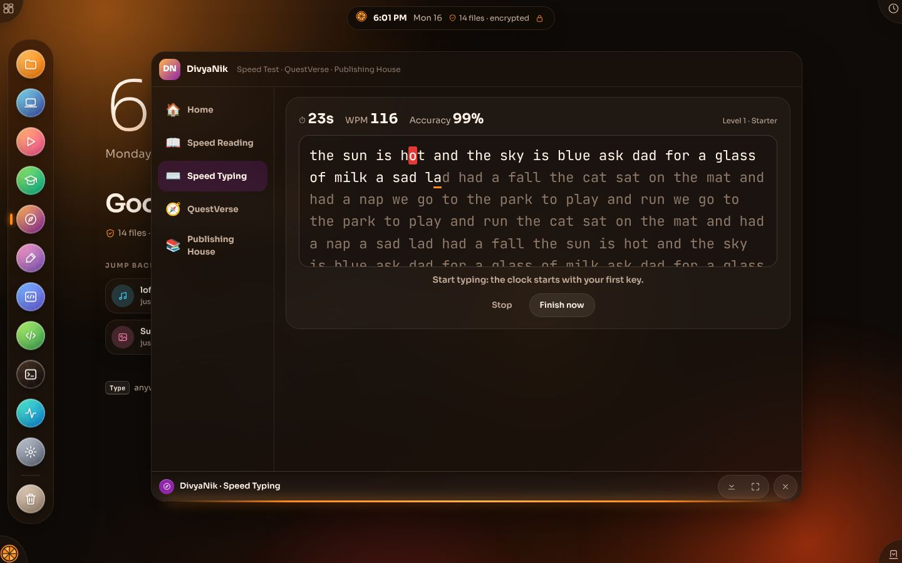 **DivyaNik Speed Typing** |  **DivyaNik QuestVerse** |
| 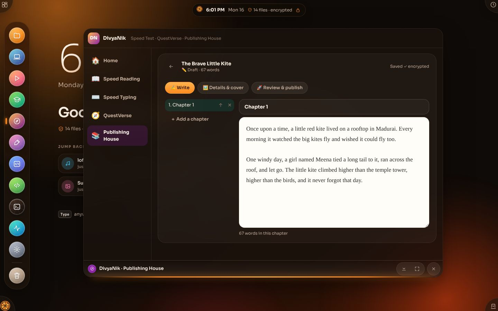 **DivyaNik Publishing House** | 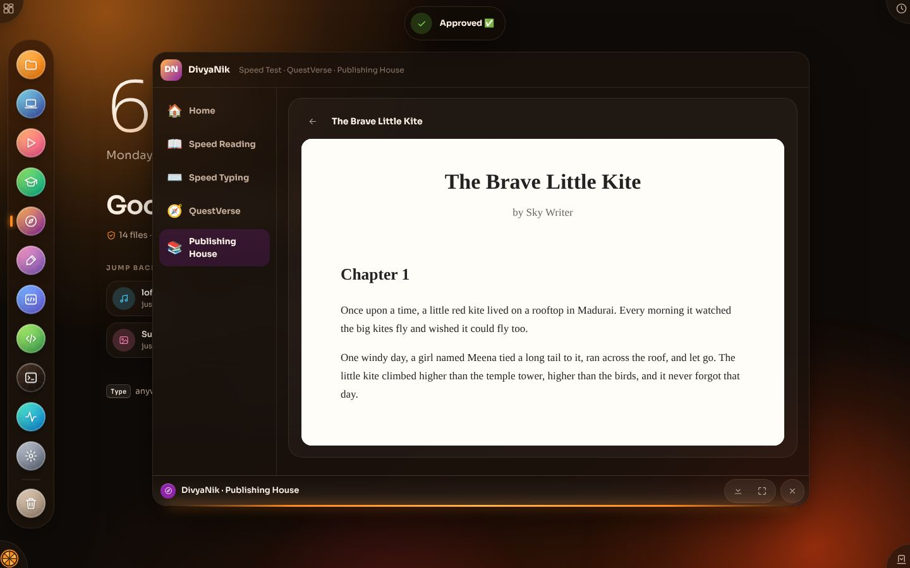 **Read, print or export EPUB** |
| 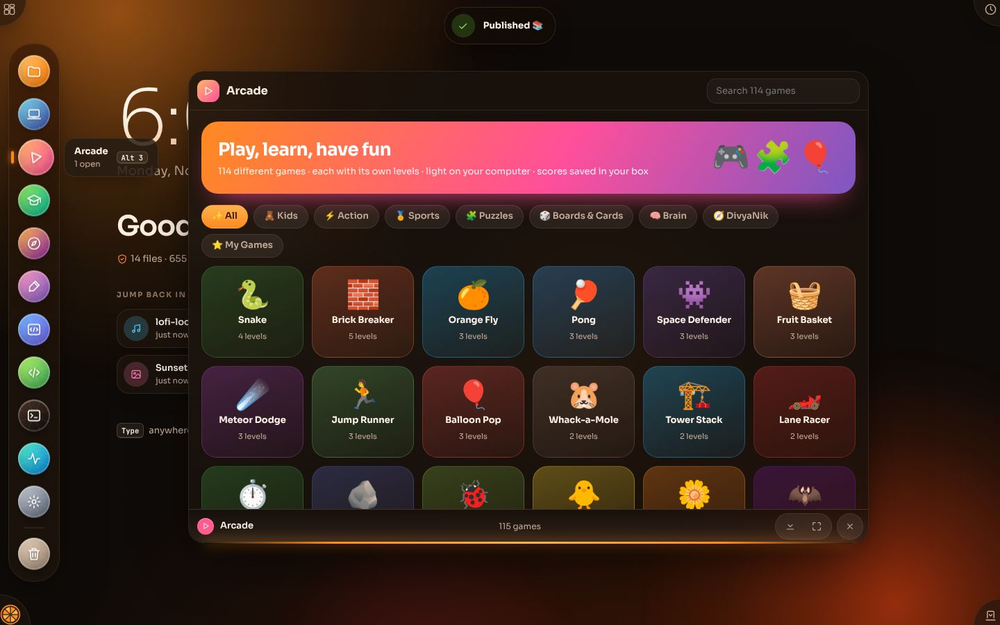 **Arcade**: 115 games, scores saved in the box | 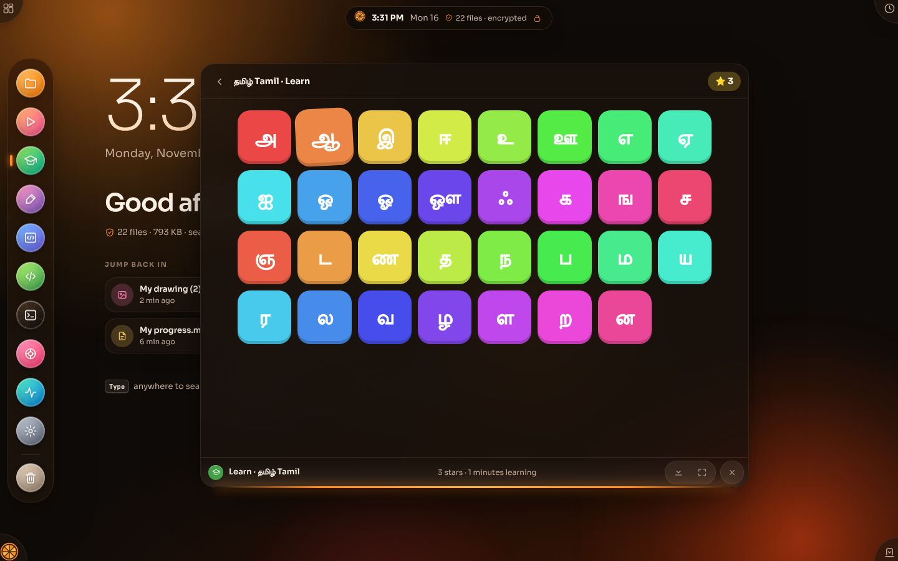 **Learn**: English, தமிழ் and numbers |
| 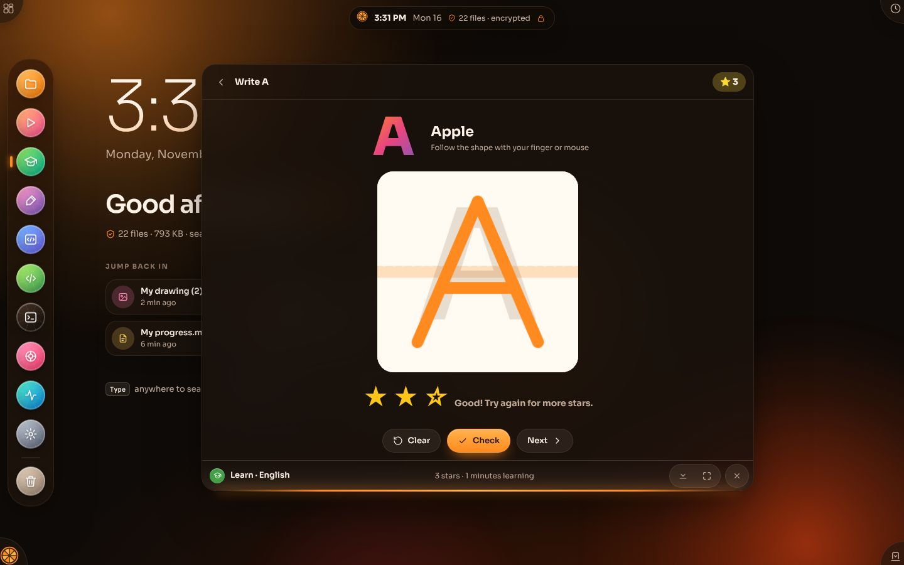 **Write**: trace the letter, earn stars | 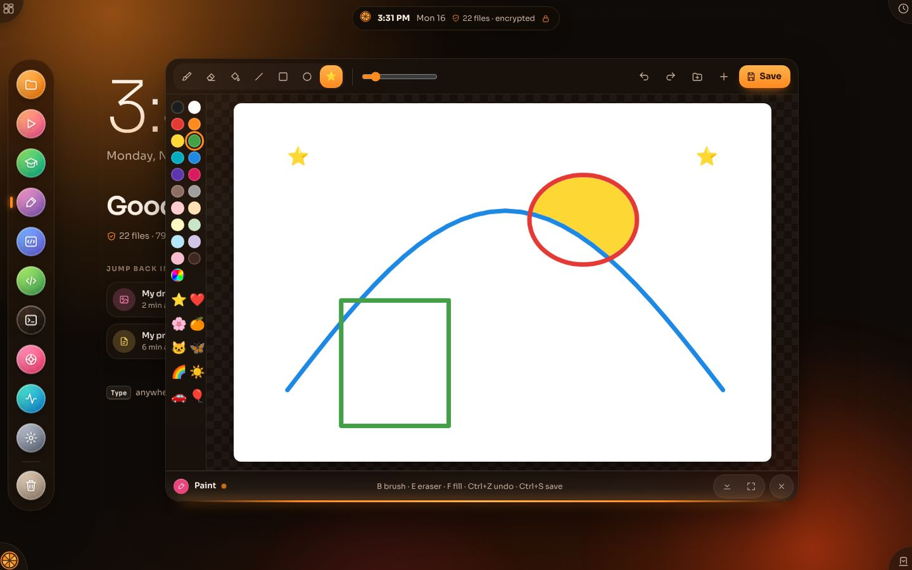 **Paint** |
| 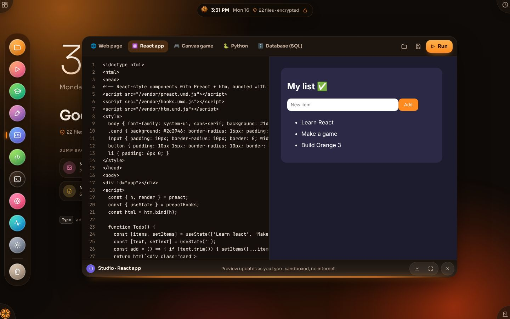 **Studio**: React with live preview | 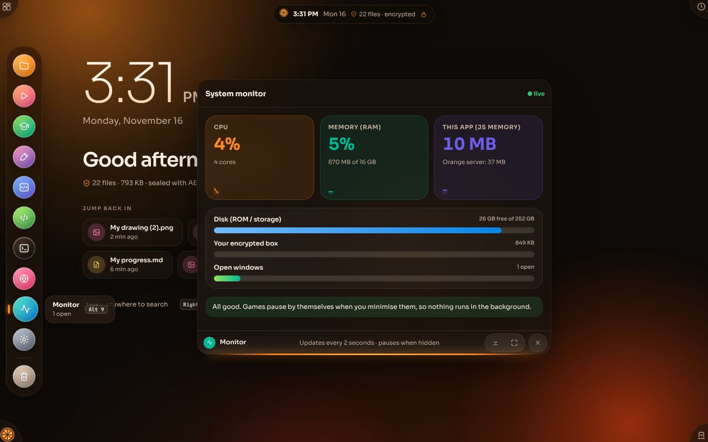 **Monitor**: RAM, CPU, disk |

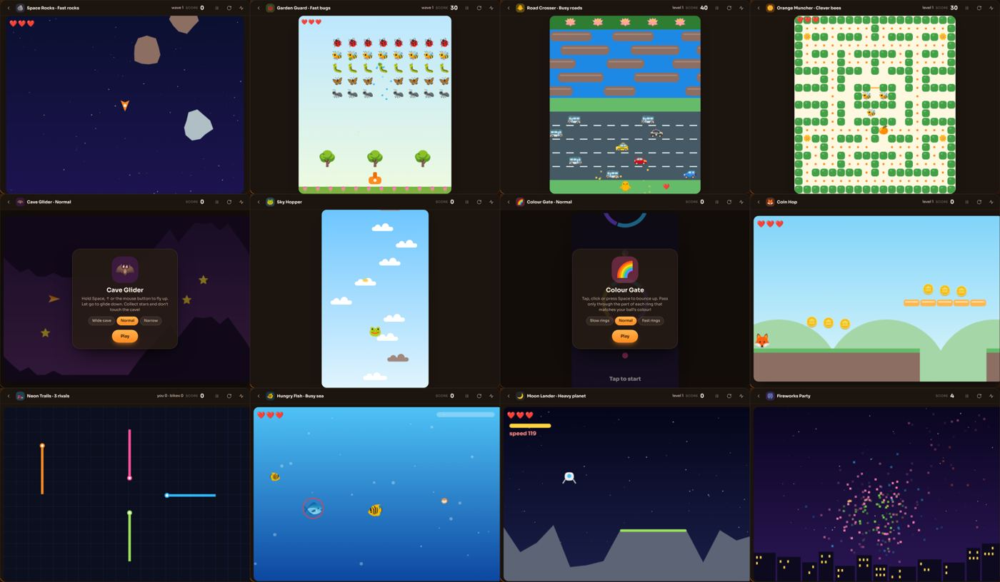

### Light on your computer

- Nothing loads until you open it: each game engine is a small file fetched the first time you play.
- Games cap at 60 fps, draw at most 1.5× resolution, and **stop completely** when you minimise the window or switch away.
- Most puzzles and learning games are plain buttons with no animation loop at all, so they use almost no CPU.
- The wallpaper uses gradients instead of live blur and **holds still while a window is open**; game windows drop the
  frosted-glass effect so the graphics chip is not re-blurring the desktop 60 times a second.
- All 107 built-in games, Learn, Paint, Studio (with React), Monitor, Computer and DivyaNik add about **500 KB** of code
  (each game file loads only when one of its games is opened); your four bundled web games add 2.1 MB.

## A different desktop, for good reasons

| | Windows / macOS | Orange |
|---|---|---|
| Window controls | Top of the window | **Bottom**, on the Base bar, next to live status |
| Right-click | A list | **Segments**: a radial menu, pick by direction |
| Search | Press a key first | **Just type** anywhere (and it does maths) |
| Apps | Taskbar / Dock at the bottom | **Rail** on the left + **Apps fan** from a corner |
| Screen corners | One (or none) | **Four**, each with a job |
| Notifications | Corner pop-ups | **The Pip**: a top-centre island with progress and Undo |
| Deleting | "Are you sure?" | Instant, with **Undo** |
| Saving | Save buttons | Saves and encrypts **while you type** |

Every choice is explained, with the research behind it (Fitts's law, marking
menus, the Doherty threshold and more), in **[docs/DESIGN.md](docs/DESIGN.md)**.


## Install

Needs Python 3.8+ (`psutil` is installed with it, for the Monitor). On Windows and macOS, Microsoft Edge or Google Chrome is used
to draw the desktop (Edge comes with Windows).

```bash
pip install --upgrade git+https://github.com/MohitOrange/orange.git
```

```bash
python -m orange install
```

`orange install` checks the encryption engine and adds the `orange` command to
your PATH. Close the terminal and open a new one, then:

```bash
orange
```

The first time, it asks for a name, a password and the password again, and
creates your box. After that, `orange` asks for your name and password and
opens the desktop.

> **Windows: `'orange' is not recognized`?** Open a *new* cmd window after
> `python -m orange install`, or use `python -m orange` instead of `orange`.

## Using the desktop

| Do this | To |
|---|---|
| Click a Rail icon (left) | Open, switch to, or sink an app |
| Throw the pointer into a **corner** | ↙ Apps · ↖ Overview · ↗ Today · ↘ Peek |
| **Type** on the empty desktop, or Ctrl+K | Search apps, files, actions, or do maths |
| **Right-click** anywhere | Segments (actions all around the pointer) |
| Drop files **anywhere** | Encrypt them into your Inbox |
| Click the **Pip** (top centre) | Today: calendar, switches, Lock, Shut down |
| Alt+Q · Alt+M · Alt+Enter | Close · Sink · Fill the active window |
| Alt+Shift+← / → | Snap the window left / right |
| Ctrl+↑ | Overview of every window |
| Ctrl+L | Lock (your key is wiped from memory) |
| ? | All shortcuts |

Closing the Orange window, choosing **Shut down**, or pressing Ctrl+C in the
terminal locks the box. It also locks itself after 10 idle minutes (change this
in Settings → Security).

## All commands

| Command | What it does |
|---|---|
| `orange install` | Set up Orange, test the encryption, add `orange` to PATH |
| `orange` | First time: create a box. After that: unlock it and open the desktop |
| `orange --windowed` | Open the desktop in a window instead of full screen |
| `orange --shell` | Use the box from the terminal only (great over SSH) |
| `orange --classic` | The simple v1 window |
| `orange new` | Create another box (another person) |
| `orange list` | List the boxes on this computer |
| `orange passwd` | Change a box's password |
| `orange destroy` | Permanently delete a box |

## Security

- **AES-256-GCM** encrypts every file (in 4 MB chunks), every file name, your
  settings and the folder tree. Any tampering is detected.
- Your password is stretched with **scrypt** (N=2^15, r=8), so guessing is slow.
- A random master key encrypts the data. The password only unlocks that key,
  so changing the password is instant. Locking wipes the key from memory.
- The desktop is served only to your own computer (127.0.0.1) on a random port,
  opened with a one-time secret. Other websites can't reach it (strict cookies,
  host checks, a required header), and decrypted data is never written to the
  browser cache.
- Boxes live in `~/.orange` (`C:\Users\<you>\.orange` on Windows). Set
  `ORANGE_HOME` to keep them somewhere else, such as a USB drive.
- **There is no password recovery.** Forget the password and the data is gone.

## Development

```bash
pip install -e . pytest
```

```bash
pytest
```

| Path | Role |
|---|---|
| `orange/crypto.py` | scrypt + AES-256-GCM |
| `orange/vault.py` | The encrypted box: files, folders, streaming and range reads |
| `orange/server.py` | The local, locked-down server behind the desktop, and the app-window launcher |
| `orange/web/` | The desktop: window manager, Segments, Pip, search, apps (no frameworks, works offline) |
| `orange/web/js/arcade/` | The game kit (`engine.js`: loop, levels, scores, performance strip), the catalog, and the games in `games/` |
| `orange/web/js/divyanik/` | DivyaNik: reading, typing, QuestVerse, Publishing House and their sample content (`data.js`) |
| `orange/hostapps.py` | Lists and opens the apps installed on this computer (Windows, macOS, Linux) |
| `orange/web/js/apps/learn.js`, `learn/data.js` | Learn: letters, words, reading levels, speech and tracing |
| `orange/web/games/` | Your own web games, bundled (GAT City, Neon Brawl, Finger Ninja, Hand Verse) |
| `orange/web/vendor/` | Preact + htm (MIT) for React-style apps in Studio |
| `orange/cli.py` | The `orange` command |
| `orange/shell.py` | The terminal-only mode |
| `orange/gui.py` | The classic v1 window |

Fonts: [Sora](https://github.com/sora-xor/sora-font) and
[JetBrains Mono](https://github.com/JetBrains/JetBrainsMono), both under the SIL
Open Font License (see `orange/web/fonts/LICENSE.txt`).

## Roadmap

- **Orange Linux**: a bootable ISO that uses this desktop as its whole shell (Dev / Play / Sec modes)
- Sync a box to a USB drive or cloud storage
- Multiple desktops and widgets

MIT license.
