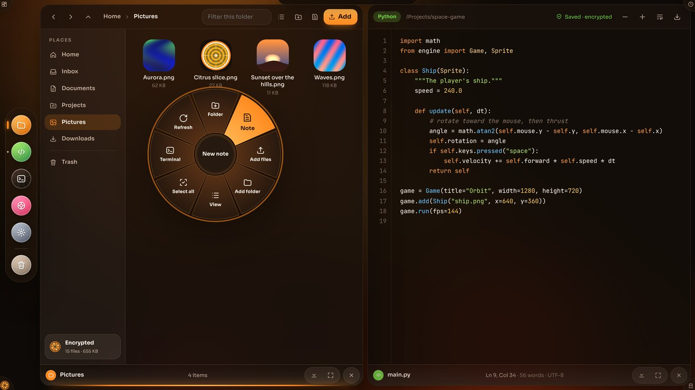

# 🍊 Orange

**An encrypted computer inside your computer.**

Like a hidden room under a house: Orange creates a locked, encrypted "box" on
your computer. Type `orange`, enter your name and password, and a whole desktop
opens full screen, with its own apps, windows, search, terminal and lock screen.
Close it and everything is sealed again. Outside the box, even the file names
are unreadable.

Works on **Windows**, **macOS** and **Linux**.


## What's inside

- **Files**: browse, drag in files and whole folders from your computer (encrypted the moment they land), photo thumbnails, Quick Look with Space, rubber-band selection, rename, move, Trash with **Undo**, drag a file out to export it.
- **Code**: an editor with syntax colours, line numbers, live Markdown/HTML preview, and **autosave + encryption as you type**.
- **Terminal**: a shell that only touches the box: `ls`, `cd`, `tree`, `cat`, `echo > file`, `find`, `neofetch` and more.
- **Lens**: photos (zoom, pan, rotate, use as wallpaper), video and music streamed straight from the encrypted box, PDFs.
- **Settings**: Night/Daylight themes, six accent colours, moving wallpapers or your own photo, motion (Full/Calm/Off), sounds, auto-lock, password change, storage ring.


## A different desktop, for good reasons

| | Windows / macOS | Orange |
|---|---|---|
| Window controls | Top of the window | **Bottom**, on the Base bar, next to live status |
| Right-click | A list | **Segments**: a radial menu, pick by direction |
| Search | Press a key first | **Just type** anywhere (and it does maths) |
| Apps | Taskbar / Dock at the bottom | **Rail** on the left + **Apps fan** from a corner |
| Screen corners | One (or none) | **Four**, each with a job |
| Notifications | Corner pop-ups | **The Pip**: a top-centre island with progress and Undo |
| Deleting | "Are you sure?" | Instant, with **Undo** |
| Saving | Save buttons | Saves and encrypts **while you type** |

Every choice is explained, with the research behind it (Fitts's law, marking
menus, the Doherty threshold and more), in **[docs/DESIGN.md](docs/DESIGN.md)**.



## Install

Needs Python 3.8+. On Windows and macOS, Microsoft Edge or Google Chrome is used
to draw the desktop (Edge comes with Windows).

```bash
pip install --upgrade git+https://github.com/MohitOrange/orange.git
```

```bash
python -m orange install
```

`orange install` checks the encryption engine and adds the `orange` command to
your PATH. Close the terminal and open a new one, then:

```bash
orange
```

The first time, it asks for a name, a password and the password again, and
creates your box. After that, `orange` asks for your name and password and
opens the desktop.

> **Windows: `'orange' is not recognized`?** Open a *new* cmd window after
> `python -m orange install`, or use `python -m orange` instead of `orange`.

## Using the desktop

| Do this | To |
|---|---|
| Click a Rail icon (left) | Open, switch to, or sink an app |
| Throw the pointer into a **corner** | ↙ Apps · ↖ Overview · ↗ Today · ↘ Peek |
| **Type** on the empty desktop, or Ctrl+K | Search apps, files, actions, or do maths |
| **Right-click** anywhere | Segments (actions all around the pointer) |
| Drop files **anywhere** | Encrypt them into your Inbox |
| Click the **Pip** (top centre) | Today: calendar, switches, Lock, Shut down |
| Alt+Q · Alt+M · Alt+Enter | Close · Sink · Fill the active window |
| Alt+Shift+← / → | Snap the window left / right |
| Ctrl+↑ | Overview of every window |
| Ctrl+L | Lock (your key is wiped from memory) |
| ? | All shortcuts |

Closing the Orange window, choosing **Shut down**, or pressing Ctrl+C in the
terminal locks the box. It also locks itself after 10 idle minutes (change this
in Settings → Security).

## All commands

| Command | What it does |
|---|---|
| `orange install` | Set up Orange, test the encryption, add `orange` to PATH |
| `orange` | First time: create a box. After that: unlock it and open the desktop |
| `orange --windowed` | Open the desktop in a window instead of full screen |
| `orange --shell` | Use the box from the terminal only (great over SSH) |
| `orange --classic` | The simple v1 window |
| `orange new` | Create another box (another person) |
| `orange list` | List the boxes on this computer |
| `orange passwd` | Change a box's password |
| `orange destroy` | Permanently delete a box |

## Security

- **AES-256-GCM** encrypts every file (in 4 MB chunks), every file name, your
  settings and the folder tree. Any tampering is detected.
- Your password is stretched with **scrypt** (N=2^15, r=8), so guessing is slow.
- A random master key encrypts the data. The password only unlocks that key,
  so changing the password is instant. Locking wipes the key from memory.
- The desktop is served only to your own computer (127.0.0.1) on a random port,
  opened with a one-time secret. Other websites can't reach it (strict cookies,
  host checks, a required header), and decrypted data is never written to the
  browser cache.
- Boxes live in `~/.orange` (`C:\Users\<you>\.orange` on Windows). Set
  `ORANGE_HOME` to keep them somewhere else, such as a USB drive.
- **There is no password recovery.** Forget the password and the data is gone.

## Development

```bash
pip install -e . pytest
```

```bash
pytest
```

| Path | Role |
|---|---|
| `orange/crypto.py` | scrypt + AES-256-GCM |
| `orange/vault.py` | The encrypted box: files, folders, streaming and range reads |
| `orange/server.py` | The local, locked-down server behind the desktop, and the app-window launcher |
| `orange/web/` | The desktop: window manager, Segments, Pip, search, apps (no frameworks, works offline) |
| `orange/cli.py` | The `orange` command |
| `orange/shell.py` | The terminal-only mode |
| `orange/gui.py` | The classic v1 window |

Fonts: [Sora](https://github.com/sora-xor/sora-font) and
[JetBrains Mono](https://github.com/JetBrains/JetBrainsMono), both under the SIL
Open Font License (see `orange/web/fonts/LICENSE.txt`).

## Roadmap

- **Orange Linux**: a bootable ISO that uses this desktop as its whole shell (Dev / Play / Sec modes)
- Run code from the Code app, inside a sandbox
- Sync a box to a USB drive or cloud storage
- Multiple desktops and widgets

MIT license.
